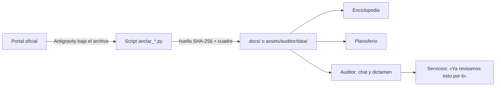

# Encargo para Antigravity: integrar la base y mejorar los Servicios

Pedido del autor, 22-11-2026: «quiero que Antigravity evalúe la plataforma: dime
qué pendientes quedaron que pueda resolver Antigravity para integrar nuestra
base de datos y mejorar nuestros servicios».

Esta hoja es la evaluación y la lista de trabajo. Se armó leyendo
[ESTADO.md](../ESTADO.md), [CONTEXT.md](../CONTEXT.md), el Registro de
pendientes (`pendientes.html`), la agenda de la base (`docs/base/agenda.json`),
las bandejas de los vigías y los flujos de GitHub, al corte del 22-11-2026.

---

## 1. Por qué a Antigravity le tocan estos

Antigravity corre **en la computadora del autor**, no en la nube. Eso le da lo
que a las sesiones en la nube les falta:

| Qué | Nube (Claude Code web) | Antigravity (computadora del autor) |
|---|---|---|
| Abrir portales de gobierno (ASF, SEMARNAT, ISSSTE, ayuntamientos) | Muchos no abren o cortan la conexión ([RED-PENDIENTE.md](RED-PENDIENTE.md)) | Abren como en el navegador del autor |
| Bajar archivos que solo salen con un botón | Hay que simularlo con Playwright | Directo |
| Archivos de cientos de MB (Marco Geoestadístico, microdatos) | Cuentan contra el disco de la sesión | Sin problema |
| Certificados incompletos de los portales | Hay que completar la cadena a mano | El sistema suele traerla |

Por eso el encargo se centra en **lo que está atorado por la red**: es donde
Antigravity rinde más que cualquier otro agente.



---

## 2. Antes de tocar nada: las cinco reglas que ya fallaron una vez

Lo que se corrigió de entregas anteriores de Antigravity (ESTADO.md, 17-11-2026).
**Que no se repita:**

1. **Rama:** se trabaja en `claude/funny-turing-imtm54` (`git pull` antes,
   `git push` al terminar). Nunca en `main`: la iguala sola el flujo «Espejo
   de main».
2. **Saltos de línea:** `asistente.js`, `index.html` y los demás de AGENTS.md §4
   van en **CRLF**; `municipios-deuda.js`, `INVENTARIO.md` y los `.py`, en
   **LF**. Windows los cambia si no se cuida: revisar con `git diff --stat`
   que no aparezca un archivo entero modificado.
3. **El sitemap y las rutas locales:** ninguna página puede ligar a un archivo
   que solo existe en la computadora del autor (pasó con 6 archivos en
   `sitemap.xml`). Los ZIP y PDF pesados **no se suben**: queda su huella.
4. **Una cifra solo entra con su documento** (AGENTS.md §2): `oficial`,
   `derivado` con su operación, o `pendiente` con su porqué, su liga y su ficha.
   Nada de solicitudes de transparencia (§0 ter). Nada de personas físicas.
5. **Terminar es pasar la revisión:**

```bash
python3 herramientas/sello.py --siguiente          # solo si tocaste assets/
python3 herramientas/revision.py --base origin/claude/funny-turing-imtm54
```

---

## 3. La evaluación, en números

| Indicador | Corte 22-11-2026 |
|---|---|
| Fichas en el Registro de pendientes | ~160 |
| De ellas, **falta de la plataforma** (el documento existe y no lo hemos integrado) | **49** |
| Falta de transparencia de la dependencia (no se puede resolver: se espera) | 13 |
| Bóveda de evidencias | 324 copiadas · 10 no abrieron · 8 sin copia |
| Lista 69-B: cambios del SAT **sin integrar** | 115 altas · 161 cambios · 1 baja · 2 nombres |
| Vigía legislativo: avisos por cotejar | 12 citas a reformas viejas · 7 hallazgos |
| Flujo «Base al día» | **Nunca ha corrido** (primera vez: miércoles 25-11-2026) |
| PR abiertos sin integrar a la rama | 4 (`#192`, `#137`, `#136`, `#115`) |

Los **49 de la plataforma** son el terreno de Antigravity. Los 13 de
transparencia no se tocan: se quedan con el nombre de quien los debe.

---

## 4. Prioridad 1 · Lo urgente (esta semana)

| # | Qué | Por qué urge | Cómo |
|---|---|---|---|
| 1.1 | **Integrar el corte nuevo de la 69-B** | El SAT ya publicó otro archivo (`mismo_archivo: false` en `docs/sat69b/bandeja.json`): 115 altas que «Revisa a tu contraparte», el lector de facturas y el chat todavía no ven. Es el corazón del Vigía de proveedores | `python3 herramientas/actualizar_69b.py && python3 herramientas/sello.py --siguiente` |
| 1.2 | **Citas a leyes reformadas** | El vigía legislativo avisa que la plataforma cita reformas viejas: **LISR** (vigente DOF 13-11-2026) en `cc_inmueble.py`, `cc_laboral.py` y `padron_sat.py`; **Código Penal Federal** (13-11-2026) en `nepotismo.py`, `integrar_glosario_nepotismo.py` y **`SV_CPF` de `apartados.py`**, que es «Lo que arriesgas» de Servicios; **Constitución** (07-10-2026) y **CFF** (09-04-2026) en los glosarios y `cc_laboral.py` | Bajar el PDF vigente de LeyesBiblio, comparar el artículo citado, cambiar fecha, huella y cita textual. **Si el artículo cambió de contenido, cambia la regla, no solo la fecha**. Lista completa: `avisos` de `docs/legislativo/bandeja.json` |
| 1.3 | **El Directorio de sancionados** | `kong-servicios-estrategico.buengobierno.gob.mx` corta la conexión desde la nube; el corte es del 17-11-2026 | `python3 herramientas/anclar_sancionados.py` desde la computadora del autor |
| 1.4 | **PEF 2027** | La agenda de la base pide revisarlo el **25-11-2026** (`pef` de `fuentes.py`): toca la Ley de Ingresos, el gasto federalizado, Megaobras y las promesas (`promesas.py`) | En cuanto salga en el DOF: integrarlo a su módulo, cambiar `corte` y `revisar` en `fuentes.py`; las promesas se actualizan solas si leen del módulo |

---

## 5. Prioridad 2 · Integrar la base (los portales que no abren desde la nube)

Cada renglón cierra una o más fichas del Registro de pendientes. Al integrarlo:
huella, cuadre, chip, su pregunta en `preguntas_auditor.json` y la ficha fuera
del registro (o con la nota de lo que sigue debiéndose).

### 5.1 Fiscalización y gasto

| Ficha(s) | Qué falta | Dónde está | Destino |
|---|---|---|---|
| `red-asf-nuevo-leon-triangulacion-cp2025-1`, `-3`, `-5` | El informe individual de la ASF de la triangulación de Nuevo León (7,200 y 5,851 mdp) | `informe.asf.gob.mx` (Cuenta Pública 2025) | Columna Verificado: pasar el cotejo de `pendiente` a `consta`/`matiz` |
| `red-asf-segunda-entrega-cp2025-3` | Las 40 denuncias por obras no hechas | ASF, informe semestral y denuncias | Ídem |
| `red-isssteson-oxigeno-pensiones-fallecidos-5` | El seguimiento de las observaciones de ISSSTESON | ASF, Sistema Público de Auditorías | Ídem |
| `promesa-dos-bocas-pef` | Lo que cada PEF 2019-2024 le asignó a la Refinería Olmeca | Tomos de PEMEX del PEF (`ppef.hacienda.gob.mx`) | `promesas.py` (se lee de su módulo) |
| `judicial-2025-costo` | El cierre ejercido de la elección judicial 2025 | Cuenta Pública 2025, INE | `asistente_judicial.py` |
| `red-lfd-2027-dnr-defensa-tren-maya-aifa-2`, `-3` | Versión estenográfica de la Comisión de Hacienda y lo que se espera recaudar | `gaceta.diputados.gob.mx`, PPEF 2027 | Columna Verificado |
| `red-jalisco-gasto-federal-pef-2027-3`, `-4` | La serie oficial de inversión de Jalisco y los programas de agua | PPEF/PEF 2027, Cuenta Pública | Columna Verificado |
| `red-carnaval-ensenada-2026-imcudhe-1`, `-3` | La información financiera del IMCUDHE y el programa oficial | `www.ensenada.gob.mx`, `www.asebc.gob.mx` | Columna Al momento |

### 5.2 Contratos y empresas (alimentan directo a Servicios)

| Ficha(s) | Qué falta | Dónde está | Destino |
|---|---|---|---|
| `grupo-ica-vinculo`, `grupo-pisa-vinculo`, `grupo-grupo-mexico-vinculo` | El documento que liste las subsidiarias de cada grupo | Reporte anual ante la BMV (`www.bmv.com.mx`), sección de subsidiarias | `GRUPOS` de `empresas_grupos.py`: el vínculo pasa de `pendiente` a `oficial` |
| `grupo-prodi-vinculo`, `grupo-prodi-tultepec`, `grupo-prodi-aztlan` | Informe anual de Mota-Engil; título de concesión de la autopista; permiso del Parque Aztlán | Mota-Engil (relación con inversionistas), periódico oficial del Edomex, Gaceta de la CDMX | Ídem. **Contrato, concesión y permiso no se confunden** (`FIGURAS`) |
| `red-salud-ventiladores-y-medicinas-4`, `red-taddei-renuncia-ine-contratos-4` | Los contratos que sostengan las sumas de la prensa | ComprasMX (ya integrado: cruzar), portal del INE y del Instituto Electoral de Sonora | Columna Verificado |
| `red-huawei-gobierno-codigo-magenta-2`, `-3` | Compras anteriores a 2025 vía otras empresas | Histórico de CompraNet 2019-2024 (`upcp-compranet.buengobierno.gob.mx`) | Ídem. **Abre además una fuente nueva**: el histórico de CompraNet, que hoy no está en la base (renglón nuevo en `fuentes.py`) |
| `red-portacelis-permiso-diesel-sener-2` | El permiso de importación de la Sener | Sener en `www.gob.mx` | Columna Verificado |
| `segob-asociaciones-religiosas` | El registro de asociaciones religiosas por entidad y credo | Gobernación (agenda: revisar **01-12-2026**) | `padron_sat.py`. **No se toma de la prensa** |

### 5.3 Salud, ambiente, territorio

| Ficha(s) | Qué falta | Dónde está | Destino |
|---|---|---|---|
| `salud-issste-servicios` | El anuario estadístico 2025 del ISSSTE (derechohabientes, consultas, cirugías) | Página de anuarios del ISSSTE (lista el de 2025, no responde desde la nube) | `anclar_salud_estados.py` y `gestion_salud.py`; lente del Planisferio |
| `salud-imss-bienestar` | Consultas y gasto completo del IMSS-Bienestar 2025 | Su informe y la DGIS | `gestion_salud.py` |
| `ambiente-0` | Las Manifestaciones de Impacto Ambiental de las megaobras | SEMARNAT, `dgiraDocs` | `am_basura.py` / Megaobras |
| `ambiente-1` | Concesión y costo de la basura por municipio | Microdatos del módulo de residuos del CNGMD (INEGI) | Planisferio (lente municipal) |
| `ambiente-por-estado` (lista de pendientes #2) | Denuncias ante la PROFEPA por entidad | Archivo de la PROFEPA | Lente estatal de la dimensión ambiental |
| `red-guaymas-comodato-amigo-gnl-8` | La autorización de la ASEA | ASEA, `www.gob.mx` | Columna Verificado |
| Lista de pendientes #1, `deuda-municipios` | El saldo de la deuda de cada municipio | Excel de Hacienda «Financiamientos de Municipios y sus Entes Públicos» | `anclar_deuda_municipios.py`. **Nunca se suma con el saldo del RPU** |

### 5.4 Leyes y congresos (alimentan los simuladores y el predial)

| Ficha(s) | Qué falta | Dónde está | Destino |
|---|---|---|---|
| `leyes-estatales` (lista #8) | Las ligas «por cotejar» de las leyes del dinero de los 32 estados | Periódicos oficiales y congresos locales | `ESTADOS` de `leyes_niveles.py` |
| `leyes-municipales` | Las leyes de ingresos municipales | Periódico oficial de cada estado | **Empezar por los municipios grandes**: cada uno cotejado entra al simulador del predial (`MUNICIPIOS` de `cc_predial.py`), que hoy trae 35 municipios, todos de Jalisco. Es el crecimiento más directo de un servicio |
| `asesores-congresos-locales`, `poderes-legislativo-0` (lista #6) | Presupuesto aprobado y remuneraciones de los 32 congresos | Portal de transparencia de cada congreso (art. 65 de la LGT) | `asistente_legislativo.py`: el tope del 0.70 % pasa de referencia a prueba |
| Lista #7 | Los umbrales del semáforo del Sistema de Alertas | Reglamento del Sistema de Alertas (DOF) | Mapa de la deuda |

### 5.5 Infraestructura de la base

| Qué | Cómo |
|---|---|
| **Bóveda: las 10 que no abrieron y las 8 sin copia** (lista #10) | Correr la bóveda desde la computadora del autor; las que abran ahí, que se copien. **Sin apagar la verificación TLS** |
| **Ligas a la Plataforma Nacional de Transparencia** (lista #9) | Cambiar cada una por el portal de la dependencia, verificada |
| **Agenda de la base** | `docs/base/agenda.json` dice `revisado: 2026-11-19` y SESNSP «sep2026», aunque ya se integró oct2026: correr `python3 herramientas/fuentes.py --agenda` |

---

## 6. Prioridad 3 · Mejorar los Servicios

| # | Qué | De dónde sale |
|---|---|---|
| 6.1 | **Revisar e integrar los PR abiertos.** El `#137` («contratos × 69-B × ASF») es el encargo 3 de la cola del autor y está sin integrar; `#192` (predial y vivienda), `#136` (dimensión social con el Censo 2020) y `#115` (el Auditor lee la nota pegada) también. Rebasar sobre la rama, pasar `revision.py` y proponer al autor cuál entra | ESTADO.md, «Encargos en cola» |
| 6.2 | **La ruta completa del impuesto** (encargo 4 de la cola) | [ENCARGO-VIGIA-Y-CFDI.md](ENCARGO-VIGIA-Y-CFDI.md) |
| 6.3 | **Las páginas internas de Servicios** (`servicio-<id>.html`, `servicios-por-que.html`…) siguen con el diseño anterior al rediseño del 21-11-2026 | CONTEXT.md, 21-11-2026 |
| 6.4 | **Página de venta del Vigía de proveedores** con un ejemplo **ficticio** (etapa 0.4): Antigravity redacta, el autor aprueba | [PLAN-IMPLEMENTACION.md](PLAN-IMPLEMENTACION.md) |
| 6.5 | **Registro de señales tempranas** (etapa 1.4): cada alta de la 69-B con su fecha, para probar después que la plataforma avisó antes | Ídem; la bandeja de la 69-B ya trae las altas |
| 6.6 | **Las consecuencias de otras leyes** en «Lo que arriesgas» (LGRA para particulares; responsabilidad penal de personas morales del CNPP), **solo si el autor las pide**, con artículo, cita textual y huella; **nunca un monto de multa** | CONTEXT.md, 21-11-2026 |
| 6.7 | **Una lente o un servicio por cada fuente nueva**: lo que entre de §5.2 va a la ficha del servicio que lo aprovecha (`FICHAS` de `servicios_fichas.py`, etiqueta «Nuevo»), y así llega al chat y a «Ya revisamos esto por ti» | AGENTS.md §0 quater |

---

## 7. Lo que no le toca a Antigravity

| Qué | De quién |
|---|---|
| Forma jurídica y RFC, pasarela de cobro, CFDI, mudanza de hospedaje | El autor (PLAN-IMPLEMENTACION.md, etapas 0.1 y 2) |
| Fecha para quitar el candado | El autor |
| Llaves de Supabase, Anthropic, Turnstile, token del INEGI | El autor, **solo en el panel**, nunca en el repositorio ni en el chat |
| Qué hacer con los 90 PDF pesados del historial | El autor |
| Pasar un flujo nuevo a `main` | El autor (GitHub programa los flujos desde `main`) |
| Los 13 pendientes por falta de transparencia (rezago civil del INEGI, concesiones mineras 2026, acuíferos nuevos, informe semestral de la ASF…) | La dependencia: se espera, no se rellena |

---

## 8. Cómo entregar cada pieza

1. Un commit por fuente o por ficha cerrada, con el mensaje en español.
2. En el mismo commit: el renglón de `fuentes.py` (`corte` y `revisar`), la
   pregunta de prueba del Auditor y la línea de ESTADO.md.
3. Al final de la sesión, en ESTADO.md: qué se cerró, qué no abrió (con el
   dominio) y qué quedó a medias. Lo que no abra ni desde la computadora del
   autor se anota en [RED-PENDIENTE.md](RED-PENDIENTE.md).
4. La siguiente sesión en la nube revisa lo que subió Antigravity, como el
   17-11-2026.
